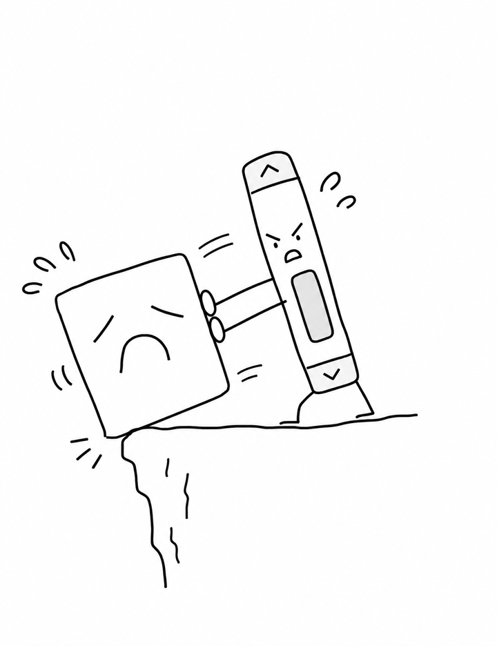
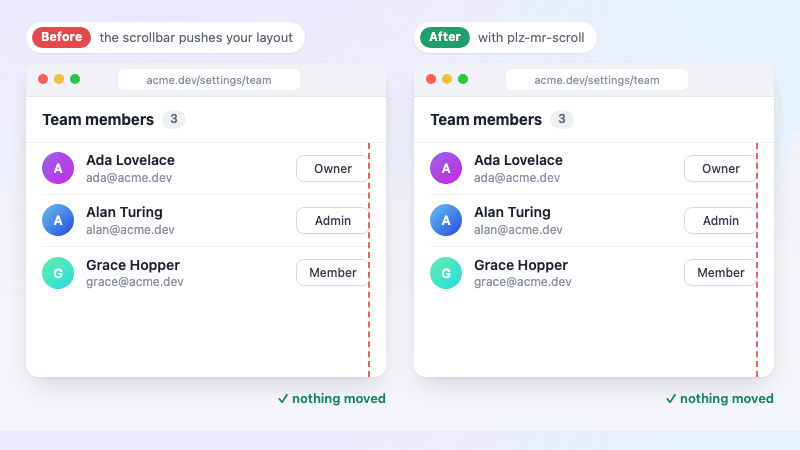
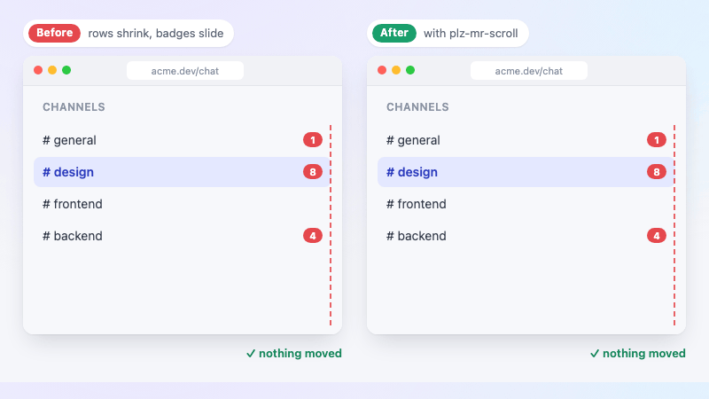
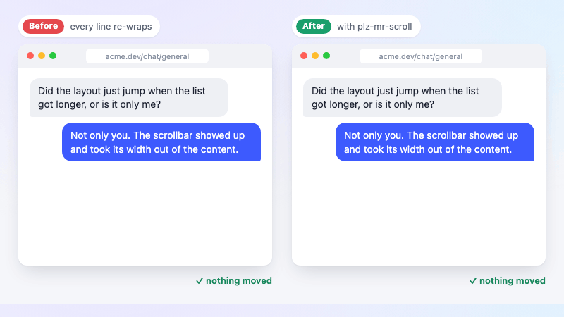
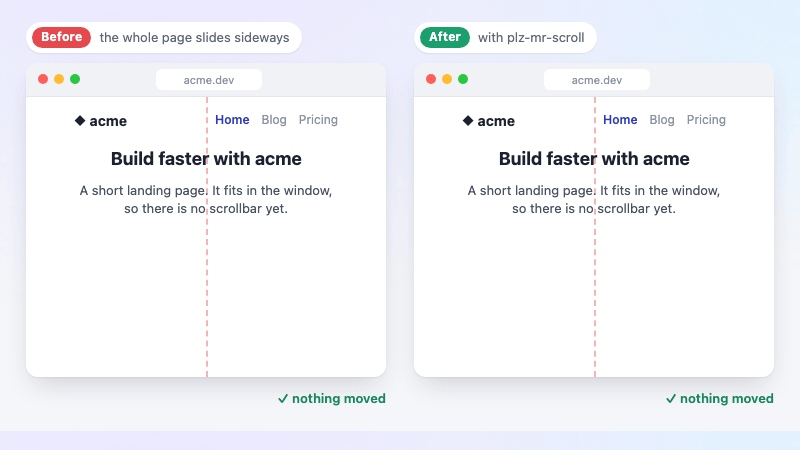
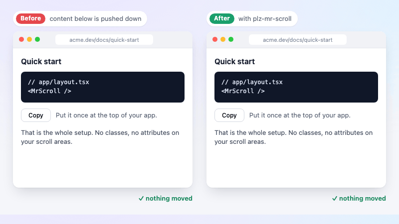
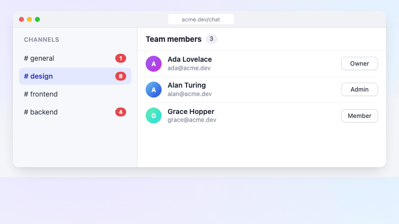

[English](./README.md) · [한국어](./README.ko.md) · **日本語** · [简体中文](./README.zh-CN.md)

<div align="center">

  

</div>

<p align="center"><sub>マナーを学ぶ前のスクロール氏。</sub></p>

<h1 align="center">Don't push me plz, Mr. Scroll.</h1>

<div align="center">

  <b>スクロールバーを紳士にするライブラリ。</b><br />
  スクロールバーが現れても、レイアウトは一歩もずれない。<br />
  <sub>場所を先に空けておかない（<code>scrollbar-gutter: stable</code> とは違う）· ブラウザ標準のスクロールバーのまま · React がなくても使える</sub>

</div>

<p align="center">
  <a href="https://justicehwan.github.io/plz-mr-scroll/"></a>
</p>

&nbsp;

<div align="center">

  

</div>

&nbsp;

**目次**

- [スクロール氏の問題](#スクロール氏の問題)
- [紳士のマナー](#紳士のマナー)
- [ほかの例](#ほかの例)
- [使い方](#使い方)
- [立ち位置を探す順序](#立ち位置を探す順序)
- [オプション](#オプション)
  - [テキストエリア（`textarea`）](#テキストエリアtextarea)
- [領域ごとの設定](#領域ごとの設定)
- [何をしたかを見る](#何をしたかを見る)
- [知っておくこと](#知っておくこと)
- [ブラウザ対応](#ブラウザ対応)
- [ドキュメント](#ドキュメント)
- [変更履歴](#変更履歴)
- [開発](#開発)
- [ライセンス](#ライセンス)

```bash
npm install plz-mr-scroll
```

```tsx
<MrScroll />
```

アプリの最上部にこの1行を置くだけでよい。画面側のコードには何も付けない。

&nbsp;

&nbsp;

## スクロール氏の問題

スクロール氏に悪気はないが、マナーもない。内容が長くなった瞬間に予告なく入ってきて、そこにあった文字やボタンを、自分の幅の分だけ横に押しのける。

- 内容がスクロールバーの幅の分だけずれる。改行位置が変わり、ボタンの位置が動く。
- 右側にスクロールバーが割り込んで、左右の余白が不揃いになる。

これまでは、次のようになだめてきた。


| よくある対処                                     | 惜しい点                                       |
| ----------------------------------------- | ------------------------------------------- |
| 場所をあらかじめ空けておく（`scrollbar-gutter: stable`） | スクロールバーが来なくても空いた椅子が残る — スクロールバーがないとき、空の帯が見える |
| 右のパディングを手で合わせる（`padding-right: 17px` など） | 領域ごとに手間がかかり、スクロールバーの幅が違うブラウザでずれる          |
| スクロールバーを自前で描く                              | ブラウザ標準のスクロールバーの動作と見た目を、一から作り直す必要がある       |


`plz-mr-scroll` はスクロール氏を追い出さないし、代役も立てない。同じスクロール氏にマナーだけを教える — 入ってくる前に立つ場所を先に探し、場所がなければ誰も押さずに静かに端に立つ。

&nbsp;

&nbsp;

## 紳士のマナー

- **押しのけない。** スクロールバーが現れる前と後で、内容の位置が同じ。
- **左右を崩さない。** スクロールバーが現れても、左右の余白が同じ。
- **人の家具を動かさない。** スクロール領域のサイズを変えない。スクロールバーがないときは、導入前と画面が同じ。
- **身なりはそのまま。** 自前で描いたスクロールバーではなく、ブラウザ標準のスクロールバーである。装飾済みの見た目（`scrollbar-width`・`scrollbar-color`・`::-webkit-scrollbar`）にもそのまま従う。
- **呼ばれなくても気を配る。** 画面の縦・横のスクロール領域を自分で見つける。領域ごとに class や属性を付ける必要はなく、後から現れるモーダルやドロップダウンも見つける。
- **去るときは片付ける。** 変更したパディングや表示を元に戻す。

上は目指しているマナーである。紳士にもできないことがある — [知っておくこと](#知っておくこと)に書いた。

&nbsp;

&nbsp;

## ほかの例

どの動画も同じ画面が2つ並んでいる — 左はライブラリなし、右は適用後。数字はその場で測った値である。

&nbsp;

| サイドバー — スクロールバーがパネルの余白に立つ | チャット — 改行位置が変わらない |
| --- | --- |
|  |  |

&nbsp;

| ページ遷移 — 中央寄せのページが中央のまま | コードブロック — 下の内容が押し下げられない |
| --- | --- |
|  |  |

&nbsp;

`debug` オプションを有効にすると、スクロール領域ごとにどう処理したかが描かれる。

&nbsp;



&nbsp;

&nbsp;

## 使い方

アプリに一度だけ組み込む。設定なしでそのまま使える。

**React**

```tsx
import { MrScroll } from "plz-mr-scroll/react";

export default function RootLayout({ children }: { children: React.ReactNode }) {
  return (
    <html>
      <body>
        <MrScroll />
        {children}
      </body>
    </html>
  );
}
```

- 画面には何も描画しない。ブラウザでマウントされた後に動作するため、サーバーレンダリングの結果には影響しない。
- コンポーネントが画面にある間だけ動く。そのため、置く場所がそのまま適用範囲になる — アプリの最上位のレイアウトに置けばアプリ全体、1ページのレイアウトに置けばそのページにいる間だけ。

**Vue · Svelte · 一般のサイト**

```ts
import { installMrScroll } from "plz-mr-scroll";

const uninstall = installMrScroll();

// 取り外すとき
uninstall();
```

- 本体は依存するライブラリがない。React は任意の依存なので、一緒にはインストールされない。
- ESM（`import`）と CommonJS（`require`）の両方が入っており、型定義も付いてくる。
- document がない環境（サーバー）で読み込んでも、何もせず静かに終わる。

**ビルドなし — CDN からそのまま**

```html
<script type="module">
  import { installMrScroll } from "https://cdn.jsdelivr.net/npm/plz-mr-scroll/+esm";

  installMrScroll();
</script>
```

- インストールもバンドラーも要らない。HTML のどこに貼ってもよい — `<head>` に置いても、文書を読み終えてから始まる。
- 本番ではバージョンを固定する: `https://cdn.jsdelivr.net/npm/plz-mr-scroll@0.2.2/+esm`。

&nbsp;

&nbsp;

## 立ち位置を探す順序

スクロール氏は、一つの方法をあらゆる場所に押し通さない。スクロールバーが現れた領域ごとに構造を見て、上から順に、合う最初の場所に立つ。


| 順序       | こんな構造なら                      | こう立つ                         | 内容を隠すか            |
| -------- | ---------------------------- | ---------------------------- | ----------------- |
| 1 自身のパディング | スクロール領域の右のパディングがスクロールバーの幅以上ある | そのパディングをスクロールバーの幅の分だけ減らし、その場所に立つ | いいえ               |
| 2 中央寄せ | 内側の内容の左右の空きが同じ           | 左にも同じ幅を足して、中央を保つ            | いいえ               |
| 3 外側の余白  | 領域のすぐ外に余白や空きがある             | 領域はそのままにして、スクロールバーだけがすぐ外に立つ  | いいえ               |
| 4 重ねる    | どこにも場所がない                   | 内容の端の上に重なって立つ — それでも押しのけはしない | つまみが置かれた部分だけ、半透明で |


- 横スクロールバーも同じ考え方で、縦とは別に場所を決める。
- スクロールバーの幅は仮定せず、そのブラウザで測った値を使う。
- 領域や内容のサイズ、要素、スタイルが変わると、見直す。
- ページ全体（ブラウザウィンドウ）のスクロール、場所を空けてある領域（`scrollbar-gutter: stable`）、スクロールバーを常に表示しておく領域（`overflow: scroll`）も扱う。
- ページ全体のスクロールでは、固定ヘッダー、フローティングボタン、中央のトーストも元の位置に保ち、スクロールをロックするモーダルともぶつからない。

方式ごとの条件と、画面に残すものは[動作の仕組み](./docs/ja/how-it-works.md)にある。

&nbsp;

&nbsp;

## オプション

何も渡さなくても動く。すべて画面全体にかける設定である。


| オプション       | 値       | デフォルト | 意味                                                              |
| ----------- | ------- | ----- | --------------------------------------------------------------- |
| `stayClose` | 数値（px）  | `12`  | スクロールバーを外側に立たせるとき、領域の端から離れてよい距離の上限。超えると内容の上に重なる                 |
| `exclude`   | CSS セレクタ | なし    | このセレクタに該当する要素とその配下には手を触れない                                      |
| `debug`     | 真偽値     | `false` | 領域ごとに何をしたかを画面に描いて見せる                                            |
| `quiet`     | 真偽値     | `true` | ブラウザが出す「ResizeObserver loop」通知を横取りする                             |
| `textarea`  | 真偽値     | `false` | テキストエリア（`textarea`）も対象にする。右のパディングがスクロールバーの幅以上のテキストエリアは、そのパディングを減らして文字幅を保つ |


```tsx
<MrScroll stayClose={4} exclude=".some-widget, .third-party" debug />
```

`installMrScroll({ ... })` にも同じ名前で渡す。オプションごとの詳細は[設定](./docs/ja/configuration.md#オプション)にある。

### テキストエリア（`textarea`）

スクロール氏は、デフォルトではテキストエリアには入らない。テキストエリアは、高さを内容に合わせるコードと干渉しやすいからだ。テキストエリアでも文字がずれるのが気になるなら、`textarea` オプションをオンにする。

```tsx
<MrScroll textarea />
```

```ts
installMrScroll({ textarea: true });
```

オンにすると、テキストエリアも他のスクロール領域と同じ順序で見る。ただしテキストエリアにはスクロールバーを浮かせられないので、実際に行われるのは次のとおり。


| テキストエリアの状態                         | オンにしたとき                                             |
| ------------------------------- | ------------------------------------------------ |
| 右のパディングがスクロールバーの幅以上ある             | そのパディングをスクロールバーの幅の分だけ減らす。文字が置かれる幅がそのままなので、改行位置は変わらない |
| 右のパディングがスクロールバーより狭い               | そのままにする。文字がスクロールバーの幅の分だけずれる                         |
| 幅を `box-sizing: content-box` で固定している（ブラウザのデフォルト） | そのままにする。パディングを減らしても文字幅は増えず、ボックスが縮むだけだからである |
| `data-scrollbar="manual"` を付けた | スクロールバーの幅（`--sbw`）だけを渡す。パディングは自分で決める               |


- **パディングを十分に取れば受け止められる。** スクロールバーの幅は、ブラウザと設定によって 11px から 17px の間である。テキストエリアの左右のパディングを `padding: 8px 16px` のように、それ以上にすればよい。
- **`box-sizing: border-box` を指定する。** 幅を数値で指定したテキストエリアは、ブラウザのデフォルト（`content-box`）では受け止められない。ほとんどの CSS リセットは、すでに `border-box` に変えている。
- **テキストエリアのサイズは変わらない。** 幅・高さを書き換えない。
- **「外側の余白」と「重ねる」はテキストエリアには適用されない。** テキストエリアにはスクロールバーを別に浮かせられないからである。
- **オフにすれば元に戻す。** オプションをオフにするか取り外すと、減らしたパディングが元の値に戻る。

&nbsp;

&nbsp;

## 領域ごとの設定

自動判定が合わない領域にだけ、スクロール要素に `data-scrollbar` を付ける。付けないのがデフォルトである。


| 値        | 動作                                                                    |
| -------- | --------------------------------------------------------------------- |
| `off`    | その領域には手を触れない                                                          |
| `center` | 左右の空きが多少違っていても、中央寄せの方式として扱う                                           |
| `manual` | 自動判定は行わず、スクロールバーの幅（`--sbw`）と高さ（`--sbh`）だけを CSS 変数として渡す。パディングは自分で決める |


使い方と注意点は[設定](./docs/ja/configuration.md#領域ごとの設定)にある。

&nbsp;

&nbsp;

## 何をしたかを見る

紳士は、自分がしたことを隠さない。`debug` をオンにすると、スクロール領域ごとに、選んだ方式と理由、スクロールバーが立った場所、減らしたり足したりしたパディングの前後の値が、画面上に描かれる。

```tsx
<MrScroll debug />
```

読み方は[トラブルシューティング](./docs/ja/troubleshooting.md#トラブルシューティング)にある。領域の位置を毎フレーム測り直すので、開発中だけオンにする。

&nbsp;

&nbsp;

## 知っておくこと

紳士にもできないことがある。

- **オーバーレイスクロールバーの環境では何もしない。** Mac のデフォルト設定やモバイルのように、スクロールバーが幅を取らなければ、そもそも誰もずれない。
- **数値で指定した右のパディングは直さない。** `padding-right: 17px` のような値は、スクロールバー用なのかデザイン上のパディングなのか判別できない。その値を消せば自動で合う。
- **スクロールバーを浮かせた領域には shadow root が残る。** 外側の余白や重ねるで受けた領域に付けるもので、一度付けた shadow root は取り外せない。その要素に後から `attachShadow` を呼ぶコードがある場合は、`data-scrollbar="off"` か `manual` を付ける。
- **スクロールバーを浮かせられないタグがある。** `ul`・`table` のように shadow root を付けられないタグには、1番・2番だけが適用される。`manual` で自分で受けることはできる。
- **対象にしない領域がある。** shadow root の中、iframe の中。テキストエリア（`textarea`）は `textarea` オプションをオンにしたときだけ対象になり、オンにしてもスクロールバーを浮かせることはできない — 右のパディングがスクロールバーより狭いテキストエリアはそのままにする。
- **浮かせたスクロールバーが置かれた場所へのクリックは、スクロールバーが受ける。** 重ねるでは、内容の右端のその幅の分が該当する。
- **判定は推定である。** 画面に描かれたサイズと余白を測って選ぶので、まれな構造では方式を誤って選ぶことがある。そのような領域は `data-scrollbar` で正す。

全体の一覧は[制約事項](./docs/ja/troubleshooting.md#制約事項)にある。

&nbsp;

&nbsp;

## ブラウザ対応


| 機能                                     | 必要なもの                                                               | ないとき                              |
| -------------------------------------- | ------------------------------------------------------------------- | --------------------------------- |
| 自身のパディング · 中央寄せ · 縦方向の重ね                | `ResizeObserver`、shadow DOM                                         | —                                 |
| 外側の余白 · 横スクロールバーを浮かせる · グリッド・横並び領域での重ね | CSS anchor positioning — Chrome・Edge 125、Safari 26、Firefox 147 から | 縦は予備の方式か重ねるに、横は元のスクロールバーのまま |


Chromium・Firefox・WebKit の3エンジンで、自動テストにより確認している。確認した範囲と確認できていない範囲は[検証状況](./docs/ja/troubleshooting.md#検証状況)にある。

&nbsp;

&nbsp;

## ドキュメント

- [動作の仕組み](./docs/ja/how-it-works.md) — 立つ場所を探す順序の詳細、再判定するタイミング、画面に残すもの
- [設定](./docs/ja/configuration.md) — 適用範囲、オプション、領域ごとの設定（`manual` の使い方）、導入時の推奨事項
- [トラブルシューティング · 制約事項 · 検証状況](./docs/ja/troubleshooting.md) — デバッグ表示の読み方、症状別の対処、制約の一覧、確認した環境

&nbsp;

&nbsp;

## 変更履歴

バージョンごとの変更点は [CHANGELOG.md](./CHANGELOG.md) にある（英語）。最新バージョンが一番上。

&nbsp;

&nbsp;

## 開発

このリポジトリを取得して、ライブラリを改修してみたい人向けのコマンドである。使うだけなら不要。

```bash
npm install
npm run dev
npm test
```

&nbsp;

&nbsp;

## ライセンス

[MIT](./LICENSE) © Justicehwan
