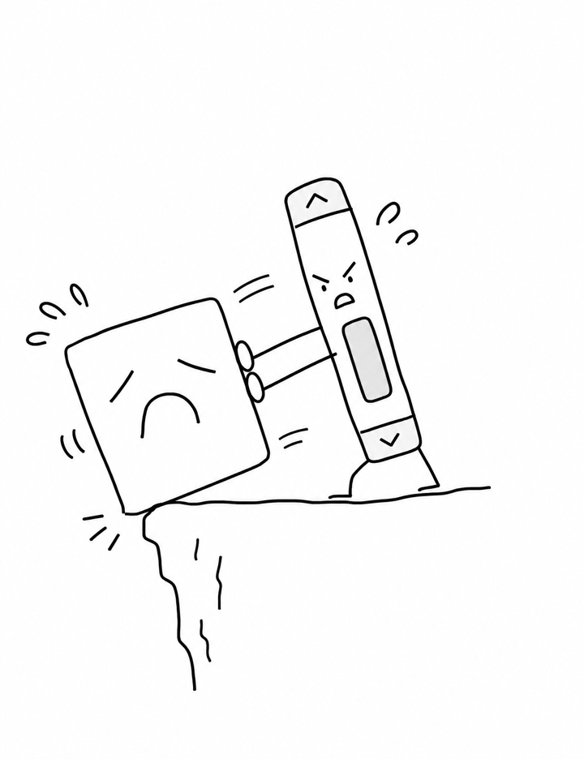
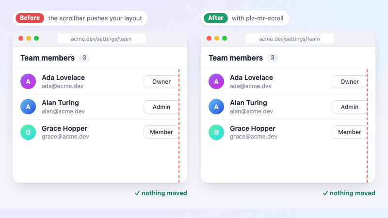
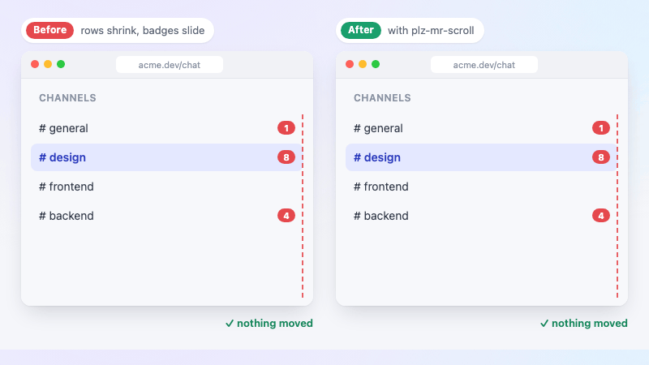
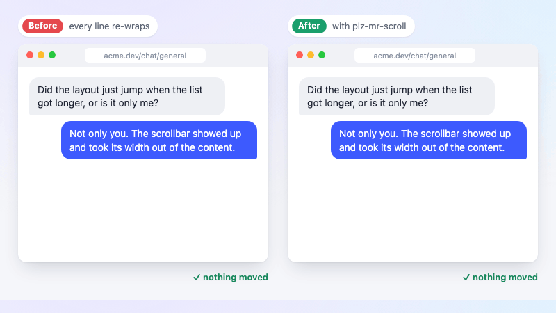
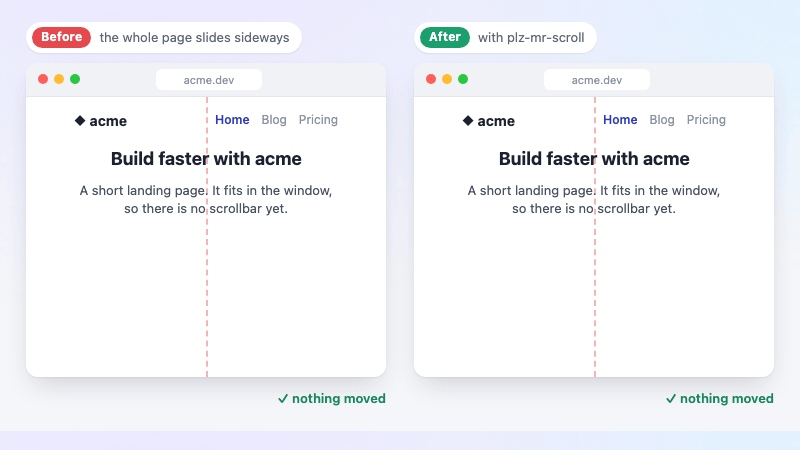
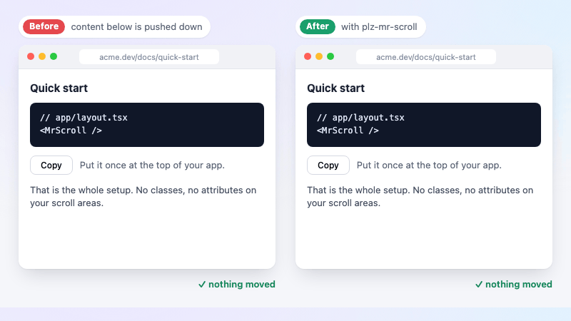
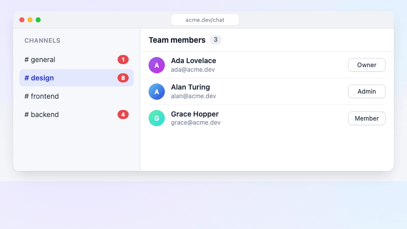

[English](./README.md) · **한국어** · [日本語](./README.ja.md) · [简体中文](./README.zh-CN.md)

<div align="center">

  

</div>

<p align="center"><sub>예절을 배우기 전의 스크롤 씨.</sub></p>

<h1 align="center">Don't push me plz, Mr. Scroll.</h1>

<div align="center">

  <b>스크롤바를 신사답게 만드는 라이브러리.</b><br />
  스크롤바가 나타나도 레이아웃은 한 발짝도 밀리지 않는다.<br />
  <sub>자리를 미리 비워 두지 않음(<code>scrollbar-gutter: stable</code> 과 다름) · 브라우저 기본 스크롤바 그대로 · React 가 없어도 됨</sub>

</div>

<div align="center">

  

</div>

<p align="center"><b><a href="https://justicehwan.github.io/plz-mr-scroll/">▶ 데모 직접 눌러 보기</a></b></p>

**목차**

- [스크롤 씨의 문제](#스크롤-씨의-문제)
- [신사의 예절](#신사의-예절)
- [더 많은 예](#더-많은-예)
- [사용법](#사용법)
- [설 자리를 찾는 순서](#설-자리를-찾는-순서)
- [옵션](#옵션)
  - [입력창(textarea)](#입력창textarea)
- [영역별 설정](#영역별-설정)
- [무엇을 했는지 보기](#무엇을-했는지-보기)
- [알아 둘 것](#알아-둘-것)
- [브라우저 지원](#브라우저-지원)
- [문서](#문서)
- [개발](#개발)
- [라이선스](#라이선스)

```bash
npm install plz-mr-scroll
```

```tsx
<MrScroll />
```

앱 맨 위에 이 한 줄이면 된다. 화면 코드에는 아무것도 붙이지 않는다.

&nbsp;

&nbsp;

## 스크롤 씨의 문제

스크롤 씨는 악의는 없고 매너도 없다. 내용이 길어지는 순간 예고 없이 들어와서, 멀쩡히 있던 글자와 버튼을 자기 폭만큼 옆으로 밀어낸다.

- 내용이 스크롤바 폭만큼 밀린다. 줄바꿈이 바뀌고 버튼 자리가 움직인다.
- 오른쪽에 스크롤바가 끼어들어 좌우 여백이 짝짝이가 된다.

지금까지는 이렇게 달래 왔다.


| 흔한 대처                                     | 아쉬운 점                                       |
| ----------------------------------------- | ------------------------------------------- |
| 자리를 미리 비워 둔다 (`scrollbar-gutter: stable`) | 스크롤 바가 안 와도 빈 의자가 남는다 — 스크롤바가 없을 때 빈 띠가 보인다 |
| 오른쪽 여백을 손으로 맞춘다 (`padding-right: 17px` 등) | 영역마다 손이 가고, 스크롤바 폭이 다른 브라우저에서 어긋난다          |
| 스크롤바를 직접 그린다                              | 브라우저 기본 스크롤바의 동작과 모양을 처음부터 다시 만들어야 한다       |


`plz-mr-scroll` 은 스크롤 씨를 내쫓지도, 대역을 세우지도 않는다. 같은 스크롤 씨에게 예절만 가르친다 — 들어서기 전에 설 자리를 먼저 찾고, 자리가 없으면 누구도 밀지 않고 조용히 가장자리에 선다.

&nbsp;

&nbsp;

## 신사의 예절

- **밀지 않는다.** 스크롤바가 생기기 전과 후에 내용의 자리가 같다.
- **좌우를 흐트러뜨리지 않는다.** 스크롤바가 생겨도 좌우 여백이 같다.
- **남의 가구를 옮기지 않는다.** 스크롤 영역의 크기를 바꾸지 않는다. 스크롤바가 없을 때는 적용하기 전과 화면이 같다.
- **차림은 그대로다.** 직접 그린 스크롤바가 아니라 브라우저 기본 스크롤바다. 꾸며 둔 모양(`scrollbar-width`·`scrollbar-color`·`::-webkit-scrollbar`)도 그대로 따른다.
- **부르지 않아도 챙긴다.** 화면의 세로·가로 스크롤 영역을 스스로 찾는다. 영역마다 class 나 속성을 붙이지 않고, 나중에 뜨는 모달·드롭다운도 찾는다.
- **떠날 때 자리를 정리한다.** 바꿔 둔 여백과 표시를 되돌린다.

위는 지향하는 예절이다. 신사도 못 하는 일이 있다 — [알아 둘 것](#알아-둘-것)에 적었다.

&nbsp;

&nbsp;

## 더 많은 예

움짤마다 같은 화면이 둘이다 — 왼쪽은 라이브러리 없이, 오른쪽은 적용한 것. 숫자는 그 자리에서 잰 값이다.

| 사이드바 — 스크롤바가 패널의 여백에 선다 | 채팅 — 줄바꿈이 그대로다 |
| --- | --- |
|  |  |

| 페이지 전환 — 가운데 놓인 페이지가 그대로 가운데 있다 | 코드 블록 — 아래 내용이 밀리지 않는다 |
| --- | --- |
|  |  |

`debug` 옵션을 켜면 스크롤 영역마다 어떻게 처리했는지가 그려진다.



&nbsp;

&nbsp;

## 사용법

앱에서 한 번만 설치한다. 설정 없이 그대로 쓰면 된다.

**React**

```tsx
import { MrScroll } from "plz-mr-scroll/react";

export default function RootLayout({ children }: { children: React.ReactNode }) {
  return (
    <html>
      <body>
        <MrScroll />
        {children}
      </body>
    </html>
  );
}
```

- 화면에는 아무것도 그리지 않는다. 브라우저에서 마운트된 뒤에 동작하므로 서버 렌더링 결과에는 영향이 없다.
- 컴포넌트가 화면에 있는 동안만 돈다. 그래서 두는 자리가 곧 적용 범위다 — 앱의 맨 위 레이아웃에 두면 앱 전체, 한 페이지의 레이아웃에 두면 그 페이지에 있는 동안만.

**Vue · Svelte · 일반 사이트**

```ts
import { installMrScroll } from "plz-mr-scroll";

const uninstall = installMrScroll();

// 걷을 때
uninstall();
```

- 본체는 기대는 라이브러리가 없다. React 는 선택 의존이라 같이 설치되지 않는다.
- ESM(`import`)과 CommonJS(`require`) 둘 다 들어 있고, 타입 정의가 같이 온다.
- 문서가 없는 곳(서버)에서 불러도 조용히 아무것도 하지 않는다.

**빌드 없이 — CDN 에서 바로**

```html
<script type="module">
  import { installMrScroll } from "https://cdn.jsdelivr.net/npm/plz-mr-scroll/+esm";

  installMrScroll();
</script>
```

- 설치도 번들러도 필요 없다. HTML 어디에 붙여도 된다 — `<head>` 에 둬도 문서를 다 읽은 뒤에 시작한다.
- 실제 서비스에서는 버전을 못박는다: `https://cdn.jsdelivr.net/npm/plz-mr-scroll@0.1.1/+esm`.

&nbsp;

&nbsp;

## 설 자리를 찾는 순서

스크롤 씨는 한 가지 방법을 모든 곳에 밀어붙이지 않는다. 스크롤바가 뜬 영역마다 구조를 보고, 위에서부터 맞는 첫 번째 자리에 선다.


| 순서       | 이런 구조면                      | 이렇게 선다                       | 내용을 가리나           |
| -------- | --------------------------- | ---------------------------- | ----------------- |
| 1 자기 여백  | 스크롤 영역의 오른쪽 여백이 스크롤바 폭 이상이다 | 그 여백을 스크롤바 폭만큼 줄이고 그 자리에 선다  | 아니오               |
| 2 가운데 정렬 | 안쪽 내용의 좌우 빈 자리가 같다          | 왼쪽에도 같은 폭을 더해 가운데를 지킨다       | 아니오               |
| 3 바깥 여백  | 영역 바로 바깥에 여백이나 빈 자리가 있다     | 영역은 그대로 두고 스크롤바만 바로 밖에 선다    | 아니오               |
| 4 겹치기    | 어디에도 자리가 없다                 | 내용의 끝 위에 겹쳐 선다 — 그래도 밀지는 않는다 | 손잡이가 놓인 곳만, 반투명으로 |


- 가로 스크롤바도 같은 뜻으로, 세로와 따로 자리를 정한다.
- 스크롤바 폭은 가정하지 않고 그 브라우저에서 잰 값을 쓴다.
- 영역이나 내용의 크기, 요소, 스타일이 바뀌면 다시 본다.
- 페이지 전체(브라우저 창) 스크롤, 자리를 비워 둔 영역(`scrollbar-gutter: stable`), 스크롤바를 늘 띄워 두는 영역(`overflow: scroll`)도 다룬다.
- 페이지 전체 스크롤에서는 화면에 고정한 헤더, 떠 있는 버튼, 가운데 띄운 알림도 제자리에 두고, 스크롤을 잠그는 모달과 부딪히지 않는다.

방식마다의 조건과 화면에 남기는 것은 [동작 방식](./docs/ko/how-it-works.md)에 있다.

&nbsp;

&nbsp;

## 옵션

아무것도 주지 않아도 동작한다. 모두 화면 전체에 거는 설정이다.


| 옵션          | 값       | 기본   | 뜻                                                               |
| ----------- | ------- | ---- | --------------------------------------------------------------- |
| `stayClose` | 숫자(px)  | `12` | 스크롤바를 바깥에 세울 때 영역의 끝에서 떨어져도 되는 거리의 한도. 넘으면 내용 위에 겹친다            |
| `exclude`   | CSS 선택자 | 없음   | 이 선택자에 걸린 요소와 그 아래는 건드리지 않는다                                    |
| `debug`     | 참·거짓    | 거짓   | 영역마다 무엇을 했는지를 화면에 그려 보여 준다                                      |
| `quiet`     | 참·거짓    | 참    | 브라우저가 남기는 「ResizeObserver loop」 알림을 가로챈다                        |
| `textarea`  | 참·거짓    | 거짓   | 입력창(`textarea`)도 본다. 오른쪽 여백이 스크롤바 폭 이상인 입력창은 그 여백을 줄여 글자 폭을 지킨다 |


```tsx
<MrScroll stayClose={4} exclude=".some-widget, .third-party" debug />
```

`installMrScroll({ ... })` 에도 같은 이름으로 준다. 옵션마다의 세부는 [설정](./docs/ko/configuration.md#옵션)에 있다.

### 입력창(`textarea`)

스크롤 씨는 기본으로는 입력창에 들어가지 않는다. 입력창은 높이를 내용에 맞추는 코드와 얽히기 쉬워서다. 입력창에서도 글자가 밀리는 것이 거슬리면 `textarea` 옵션을 켠다.

```tsx
<MrScroll textarea />
```

```ts
installMrScroll({ textarea: true });
```

켜면 입력창도 다른 스크롤 영역과 같은 순서로 본다. 다만 입력창에는 스크롤바를 띄울 수 없어서, 실제로 되는 것은 아래와 같다.


| 입력창의 상태                         | 켰을 때                                             |
| ------------------------------- | ------------------------------------------------ |
| 오른쪽 여백이 스크롤바 폭 이상이다             | 그 여백을 스크롤바 폭만큼 줄인다. 글자가 놓이는 폭이 그대로라 줄바꿈이 바뀌지 않는다 |
| 오른쪽 여백이 스크롤바보다 좁다               | 그대로 둔다. 글자가 스크롤바 폭만큼 밀린다                         |
| 폭을 `box-sizing: content-box` 로 못박았다(브라우저 기본값) | 그대로 둔다. 여백을 줄여도 글자 폭이 늘지 않고 상자만 줄어들기 때문이다 |
| `data-scrollbar="manual"` 을 붙였다 | 스크롤바 폭(`--sbw`)만 내려 준다. 여백은 직접 정한다               |


- **여백을 넉넉히 주면 받는다.** 스크롤바 폭은 브라우저와 설정에 따라 11px 에서 17px 사이다. 입력창의 좌우 여백을 `padding: 8px 16px` 처럼 그 이상으로 주면 된다.
- **`box-sizing: border-box` 를 준다.** 폭을 숫자로 준 입력창은 브라우저 기본값(`content-box`)에서는 받지 못한다. 대부분의 CSS 초기화는 이미 `border-box` 로 바꿔 둔다.
- **입력창의 크기는 바뀌지 않는다.** 폭·높이를 고쳐 쓰지 않는다.
- **「바깥 여백」과 「겹치기」는 입력창에 적용되지 않는다.** 입력창에는 스크롤바를 따로 띄울 수 없기 때문이다.
- **끄면 되돌린다.** 옵션을 끄거나 걷으면 줄여 둔 여백이 원래 값으로 돌아온다.

&nbsp;

&nbsp;

## 영역별 설정

자동 판별이 맞지 않는 영역에만 스크롤 요소에 `data-scrollbar` 를 붙인다. 붙이지 않는 것이 기본이다.


| 값        | 동작                                                                    |
| -------- | --------------------------------------------------------------------- |
| `off`    | 그 영역은 건드리지 않는다                                                        |
| `center` | 좌우 빈 자리가 조금 달라도 가운데 정렬 방식으로 본다                                        |
| `manual` | 자동 판별을 하지 않고, 스크롤바 폭(`--sbw`)과 높이(`--sbh`)만 CSS 변수로 내려 준다. 여백은 직접 정한다 |


쓰는 법과 주의할 점은 [설정](./docs/ko/configuration.md#영역별-설정)에 있다.

&nbsp;

&nbsp;

## 무엇을 했는지 보기

신사는 자기가 한 일을 숨기지 않는다. `debug` 를 켜면 스크롤 영역마다 고른 방식과 까닭, 스크롤바가 선 자리, 줄이거나 더한 여백의 전·후 값이 화면 위에 그려진다.

```tsx
<MrScroll debug />
```

읽는 법은 [문제 해결](./docs/ko/troubleshooting.md#문제-해결)에 있다. 영역들의 자리를 매 프레임 다시 재므로 개발 중에만 켠다.

&nbsp;

&nbsp;

## 알아 둘 것

신사도 못 하는 일이 있다.

- **겹쳐 뜨는 스크롤바 환경에서는 아무것도 하지 않는다.** 맥의 기본 설정이나 모바일처럼 스크롤바가 폭을 차지하지 않으면 애초에 아무도 밀리지 않는다.
- **숫자로 넣은 오른쪽 여백은 고치지 않는다.** `padding-right: 17px` 같은 값은 스크롤바용인지 디자인 여백인지 알 수 없다. 그 값을 지우면 자동으로 맞는다. 
- **스크롤바를 띄운 영역에는 shadow root 가 남는다.** 바깥 여백·겹치기로 받은 영역에 붙이고, 한 번 붙인 shadow root 는 떼어 낼 수 없다. 그 요소에 나중에 `attachShadow` 를 부르는 코드가 있으면 `data-scrollbar="off"` 나 `manual` 을 붙인다.
- **스크롤바를 띄울 수 없는 태그가 있다.** `ul`·`table` 처럼 shadow root 를 붙일 수 없는 태그는 1·2번만 적용된다. `manual` 로 직접 받을 수 있다.
- **보지 않는 영역이 있다.** shadow root 안, iframe 안. 입력창(`textarea`)은 `textarea` 옵션을 켜야 보고, 켜도 스크롤바를 띄우지는 못한다 — 오른쪽 여백이 스크롤바보다 좁은 입력창은 그대로 둔다.
- **띄운 스크롤바가 놓인 자리의 클릭은 스크롤바가 받는다.** 겹치기에서는 내용의 오른쪽 끝 그 폭만큼이 해당한다.
- **판별은 추정이다.** 화면에 그려진 크기와 여백을 재서 고르므로, 드문 구조에서는 방식을 잘못 고를 수 있다. 그런 영역은 `data-scrollbar` 로 바로잡는다.

전체 목록은 [제약사항](./docs/ko/troubleshooting.md#제약사항)에 있다.

&nbsp;

&nbsp;

## 브라우저 지원


| 기능                                     | 필요한 것                                                               | 없으면                               |
| -------------------------------------- | ------------------------------------------------------------------- | --------------------------------- |
| 자기 여백 · 가운데 정렬 · 세로 겹치기                | `ResizeObserver`, shadow DOM                                        | —                                 |
| 바깥 여백 · 가로 스크롤바 띄우기 · 격자·가로 배치 영역의 겹치기 | CSS anchor positioning — Chrome·Edge 125, Safari 26, Firefox 147 부터 | 세로는 예비 방식이나 겹치기로, 가로는 원래 스크롤바 그대로 |


Chromium · Firefox · WebKit 세 엔진에서 자동 테스트로 확인한다. 확인한 범위와 못 한 범위는 [검증 현황](./docs/ko/troubleshooting.md#검증-현황)에 있다.

&nbsp;

&nbsp;

## 문서

- [동작 방식](./docs/ko/how-it-works.md) — 자리를 찾는 순서의 세부, 다시 판별하는 때, 화면에 남기는 것
- [설정](./docs/ko/configuration.md) — 적용 범위, 옵션, 영역별 설정(`manual` 쓰는 법), 적용 시 권장사항
- [문제 해결 · 제약사항 · 검증 현황](./docs/ko/troubleshooting.md) — 진단 표시 읽는 법, 증상별 대처, 제약 전체, 확인한 환경

&nbsp;

&nbsp;

## 개발

이 레포를 받아서 라이브러리를 고쳐 보려는 사람을 위한 명령이다. 쓰기만 할 때는 필요 없다.

```bash
npm install
npm run dev
npm test
```

&nbsp;

&nbsp;

## 라이선스

[MIT](./LICENSE) © Justicehwan