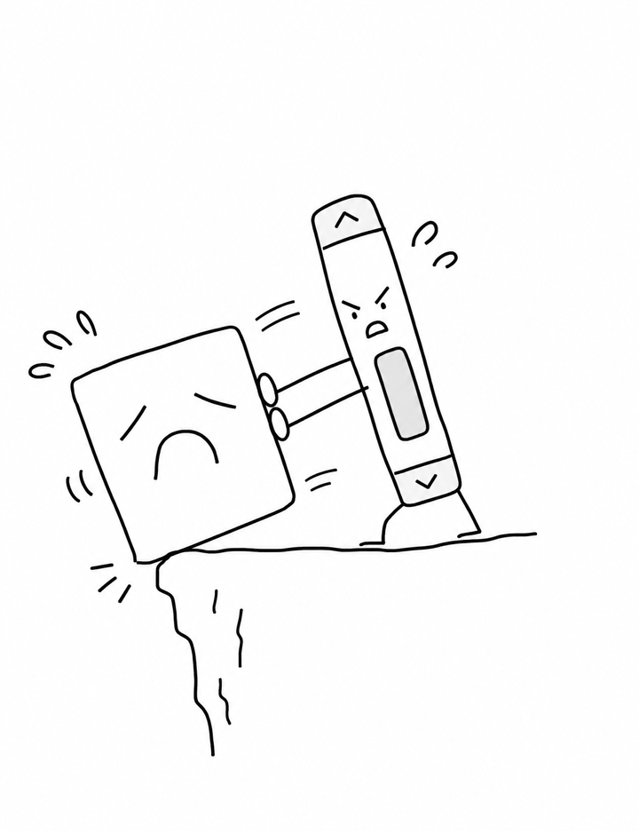
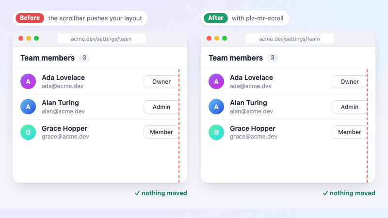
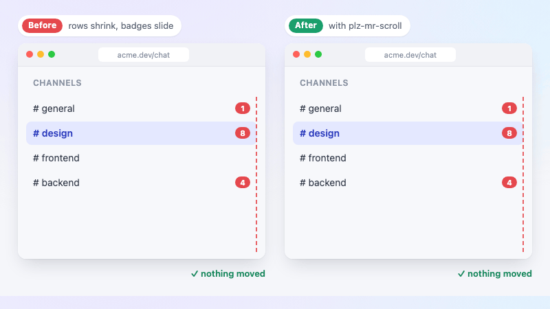
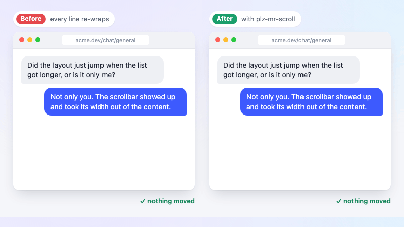
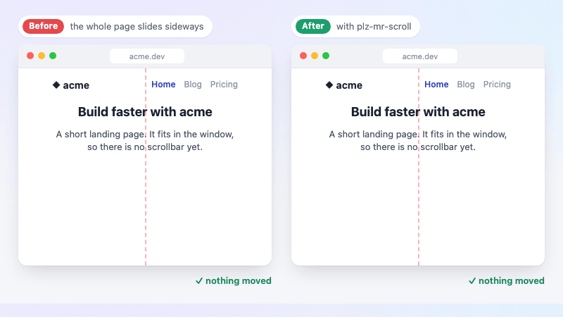
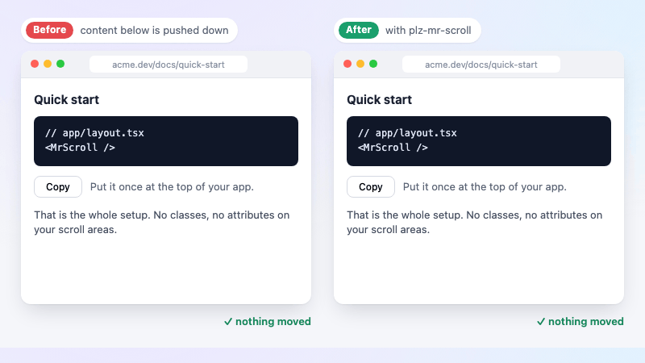
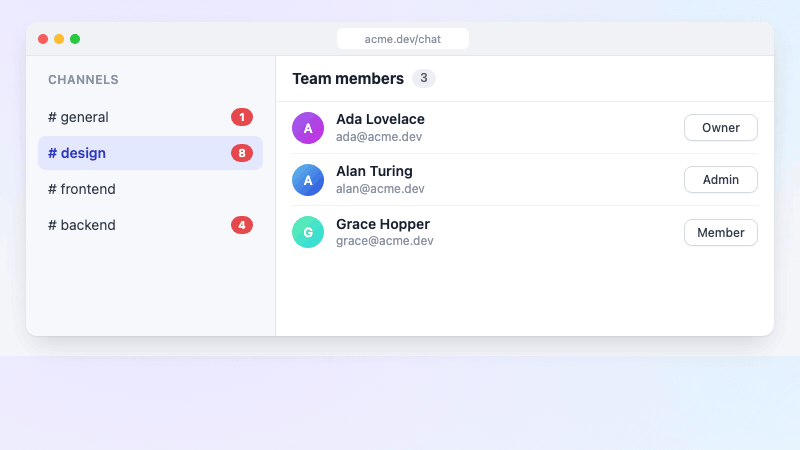

**English** · [한국어](./README.ko.md) · [日本語](./README.ja.md) · [简体中文](./README.zh-CN.md)

<div align="center">

  

</div>

<p align="center"><sub>Mr. Scroll, before he learned his manners.</sub></p>

<h1 align="center">Don't push me plz, Mr. Scroll.</h1>

<div align="center">

  <b>A library that turns your scrollbar into a gentleman.</b><br />
  The scrollbar shows up, and the layout doesn't move an inch.<br />
  <sub>No reserved gutter (unlike <code>scrollbar-gutter: stable</code>) · the native scrollbar · React or no framework at all</sub>

</div>

<div align="center">

  

</div>

<p align="center"><b><a href="https://justicehwan.github.io/plz-mr-scroll/">▶ Try the live demo</a></b></p>

**Contents**

- [Mr. Scroll's problem](#mr-scrolls-problem)
- [A gentleman's manners](#a-gentlemans-manners)
- [More examples](#more-examples)
- [Usage](#usage)
- [Finding a place to stand](#finding-a-place-to-stand)
- [Options](#options)
  - [Text areas (textarea)](#text-areas-textarea)
- [Per-area settings](#per-area-settings)
- [Seeing what it did](#seeing-what-it-did)
- [Things to know](#things-to-know)
- [Browser support](#browser-support)
- [Documentation](#documentation)
- [Development](#development)
- [License](#license)

```bash
npm install plz-mr-scroll
```

```tsx
<MrScroll />
```

Put this one line at the top of your app. Your app code needs nothing else.

&nbsp;

&nbsp;

## Mr. Scroll's problem

Mr. Scroll means no harm, but he has no manners. The moment your content gets long, he barges in unannounced and shoves the text and buttons that were sitting there perfectly well aside by his own width.

- Content shifts by the scrollbar's width. Line breaks change and buttons move.
- The scrollbar wedges in on the right, so the left and right padding no longer match.

Until now, we've kept him in line like this.


| Common workaround | The catch |
| --- | --- |
| Reserve his seat in advance (`scrollbar-gutter: stable`) | The chair stays empty even when he doesn't show up — you see a blank strip when there's no scrollbar |
| Tune the right padding by hand (`padding-right: 17px`, etc.) | Every area needs hand-tuning, and it breaks in browsers with a different scrollbar width |
| Draw your own scrollbar | You rebuild the native scrollbar's behavior and look from scratch |


`plz-mr-scroll` doesn't throw Mr. Scroll out or hire a stand-in. It just teaches the same Mr. Scroll some manners — before he steps in, he finds a place to stand, and if there's no room, he stands quietly at the edge without pushing anyone.

&nbsp;

&nbsp;

## A gentleman's manners

- **He doesn't push.** Content sits in the same place before and after the scrollbar appears.
- **He keeps both sides even.** Left and right padding stay equal when the scrollbar appears.
- **He doesn't rearrange the furniture.** It never changes the size of a scroll area. With no scrollbar, the page looks exactly as it did before you added it.
- **He comes as he is.** It's the browser's native scrollbar, not a custom-drawn one. It also follows your styling (`scrollbar-width`, `scrollbar-color`, `::-webkit-scrollbar`).
- **He doesn't wait to be asked.** It finds vertical and horizontal scroll areas on the page by itself. You don't add a class or attribute to each area, and it also finds modals and dropdowns that appear later.
- **He tidies up when he leaves.** It restores the padding and markers it changed.

These are the manners he aims for. Even a gentleman can't do everything — see [Things to know](#things-to-know).

&nbsp;

&nbsp;

## More examples

Each clip shows the same screen twice — left without the library, right with it. The numbers are measured live.

| Sidebar — the scrollbar stands in the panel padding | Chat — lines keep their wrapping |
| --- | --- |
|  |  |

| Page jump — a centered page stays centered | Code block — nothing below is pushed down |
| --- | --- |
|  |  |

With the `debug` option on, each scroll area shows how it was handled.



&nbsp;

&nbsp;

## Usage

Install it once in your app. It works as is, with no configuration.

**React**

```tsx
import { MrScroll } from "plz-mr-scroll/react";

export default function RootLayout({ children }: { children: React.ReactNode }) {
  return (
    <html>
      <body>
        <MrScroll />
        {children}
      </body>
    </html>
  );
}
```

- It renders nothing. It starts after it mounts in the browser, so it doesn't affect server-rendered output.
- It runs only while the component is mounted, so where you place it sets its scope — in your app's root layout it covers the whole app; in one page's layout, only while that page is open.

**Vue · Svelte · plain JavaScript**

```ts
import { installMrScroll } from "plz-mr-scroll";

const uninstall = installMrScroll();

// to uninstall
uninstall();
```

- The core has no dependencies. React is an optional peer dependency, so it isn't installed along with it.
- It ships both ESM (`import`) and CommonJS (`require`), with type definitions included.
- Calling it where there's no document (on the server) quietly does nothing.

**No build step — straight from a CDN**

```html
<script type="module">
  import { installMrScroll } from "https://cdn.jsdelivr.net/npm/plz-mr-scroll/+esm";

  installMrScroll();
</script>
```

- Nothing to install and no bundler. Paste it into any HTML page — in `<head>` too, since it waits for the document to load.
- For production, pin a version: `https://cdn.jsdelivr.net/npm/plz-mr-scroll@0.2.0/+esm`.

&nbsp;

&nbsp;

## Finding a place to stand

Mr. Scroll doesn't force one approach everywhere. For each scroll area that shows a scrollbar, he looks at its structure and takes the first place from the top that fits.


| Order | If the structure is | He stands | Covers content? |
| --- | --- | --- | --- |
| 1 Own padding | The scroll area's right padding is at least the scrollbar width | Shrinks that padding by the scrollbar width and stands in its place | No |
| 2 Centered | The content inside has equal space on the left and right | Adds the same width on the left too, keeping the content centered | No |
| 3 Outside | There's a margin or empty space just outside the area | Leaves the area as is and stands just outside it | No |
| 4 Overlay | There's no room anywhere | Stands over the edge of the content — still without pushing it | Only under the thumb, semi-transparent |


- The horizontal scrollbar works the same way, with its place decided separately from the vertical one.
- It never assumes the scrollbar width; it uses the value measured in that browser.
- It looks again whenever the size of the area or its content, the elements, or the styles change.
- It also handles page (browser window) scrolling, areas that reserve the scrollbar's space (`scrollbar-gutter: stable`), and areas that always show a scrollbar (`overflow: scroll`).
- On page scrolling it also keeps fixed headers, floating buttons and centered toasts where they were, and stays out of the way of modals that lock scrolling.

The conditions for each method and what it leaves on the page are in [How it works](./docs/en/how-it-works.md).

&nbsp;

&nbsp;

## Options

It works with no options at all. Every option applies to the whole page.


| Option | Value | Default | Meaning |
| --- | --- | --- | --- |
| `stayClose` | number (px) | `12` | How far from the area's edge the scrollbar may sit when placed outside. Beyond this, it overlays the content |
| `exclude` | CSS selector | none | Elements matching this selector, and everything inside them, are left alone |
| `debug` | boolean | `false` | Draws what it did to each area on the page |
| `quiet` | boolean | `true` | Intercepts the "ResizeObserver loop" notices the browser emits |
| `textarea` | boolean | `false` | Also handles text areas (`textarea`). For text areas whose right padding is at least the scrollbar width, it shrinks that padding to keep the text width |


```tsx
<MrScroll stayClose={4} exclude=".some-widget, .third-party" debug />
```

`installMrScroll({ ... })` takes the same names. Details for each option are in [Configuration](./docs/en/configuration.md#options).

### Text areas (`textarea`)

By default, Mr. Scroll stays out of text areas, because they easily get tangled up with code that sizes their height to the content. If text shifting inside text areas bothers you, turn on the `textarea` option.

```tsx
<MrScroll textarea />
```

```ts
installMrScroll({ textarea: true });
```

With it on, text areas go through the same order as other scroll areas. But a scrollbar can't be floated on a text area, so here's what actually happens.


| Text area | With the option on |
| --- | --- |
| Right padding is at least the scrollbar width | Shrinks that padding by the scrollbar width. The width available to the text stays the same, so line breaks don't change |
| Right padding is narrower than the scrollbar | Left as is. The text shifts by the scrollbar width |
| Width fixed in `box-sizing: content-box` terms (the browser default) | Left as is. Shrinking the padding wouldn't widen the text; it would only shrink the box |
| Has `data-scrollbar="manual"` | Only passes down the scrollbar width (`--sbw`). You set the padding yourself |


- **Give it enough padding and it fits.** Scrollbar width ranges from 11px to 17px, depending on the browser and settings. Give the text area horizontal padding at least that wide, such as `padding: 8px 16px`.
- **Use `box-sizing: border-box`.** A text area with a numeric width can't take the scrollbar under the browser default (`content-box`). Most CSS resets already switch to `border-box`.
- **The text area's size never changes.** Width and height are never rewritten.
- **"Outside" and "Overlay" don't apply to text areas.** A scrollbar can't be floated separately on a text area.
- **Turning it off restores everything.** Turning the option off or uninstalling puts the shrunk padding back to its original value.

&nbsp;

&nbsp;

## Per-area settings

Add `data-scrollbar` to the scroll element only for areas where automatic detection gets it wrong. Leaving it off is the default.


| Value | Behavior |
| --- | --- |
| `off` | Leaves that area alone |
| `center` | Treats the area as centered even if the space on the left and right differs slightly |
| `manual` | Skips automatic detection and only passes down the scrollbar width (`--sbw`) and height (`--sbh`) as CSS variables. You set the padding yourself |


How to use it and what to watch for are in [Configuration](./docs/en/configuration.md#per-area-settings).

&nbsp;

&nbsp;

## Seeing what it did

A gentleman doesn't hide what he's done. Turn on `debug`, and for each scroll area the page shows the chosen method and the reason, where the scrollbar stands, and the before and after values of any padding it shrank or added.

```tsx
<MrScroll debug />
```

How to read it is in [Troubleshooting](./docs/en/troubleshooting.md#troubleshooting). It re-measures the position of every area on every frame, so turn it on only during development.

&nbsp;

&nbsp;

## Things to know

Even a gentleman can't do everything.

- **It does nothing with overlay scrollbars.** If the scrollbar takes no space, as with the macOS default or on mobile, nobody gets pushed in the first place.
- **It doesn't touch hard-coded right padding.** It can't tell whether a value like `padding-right: 17px` is for the scrollbar or part of the design. Remove it and things line up automatically.
- **Areas with a floated scrollbar keep a shadow root.** It's attached to areas handled by Outside or Overlay, and a shadow root can't be removed once attached. If code later calls `attachShadow` on that element, add `data-scrollbar="off"` or `manual`.
- **Some tags can't take a floated scrollbar.** Tags that can't have a shadow root, like `ul` and `table`, only get methods 1 and 2. You can handle them yourself with `manual`.
- **Some areas aren't handled.** Areas inside a shadow root or inside an iframe. Text areas (`textarea`) are handled only with the `textarea` option on, and even then they can't get a floated scrollbar — text areas whose right padding is narrower than the scrollbar are left as is.
- **Clicks where a floated scrollbar sits go to the scrollbar.** With Overlay, that's a strip as wide as the scrollbar along the right edge of the content.
- **Detection is an estimate.** It measures the rendered sizes and padding to decide, so with unusual structures it can pick the wrong method. Fix those areas with `data-scrollbar`.

The full list is in [Limitations](./docs/en/troubleshooting.md#limitations).

&nbsp;

&nbsp;

## Browser support


| Feature | Requires | Without it |
| --- | --- | --- |
| Own padding · Centered · vertical Overlay | `ResizeObserver`, shadow DOM | — |
| Outside · floated horizontal scrollbar · Overlay in grid and horizontal layouts | CSS anchor positioning — Chrome and Edge 125, Safari 26, Firefox 147 and later | Vertical falls back to widening or Overlay; horizontal keeps the original scrollbar |


Tested automatically on three engines: Chromium, Firefox, and WebKit. What was and wasn't covered is in [Verification status](./docs/en/troubleshooting.md#verification-status).

&nbsp;

&nbsp;

## Documentation

- [How it works](./docs/en/how-it-works.md) — the order for finding a place in detail, when it re-evaluates, what it leaves on the page
- [Configuration](./docs/en/configuration.md) — scope, options, per-area settings (how to use `manual`), recommendations
- [Troubleshooting · Limitations · Verification status](./docs/en/troubleshooting.md) — reading the debug overlay, fixes by symptom, the full list of limitations, tested environments

&nbsp;

&nbsp;

## Development

These commands are for anyone who clones this repo to work on the library. You don't need them just to use it.

```bash
npm install
npm run dev
npm test
```

&nbsp;

&nbsp;

## License

[MIT](./LICENSE) © Justicehwan
