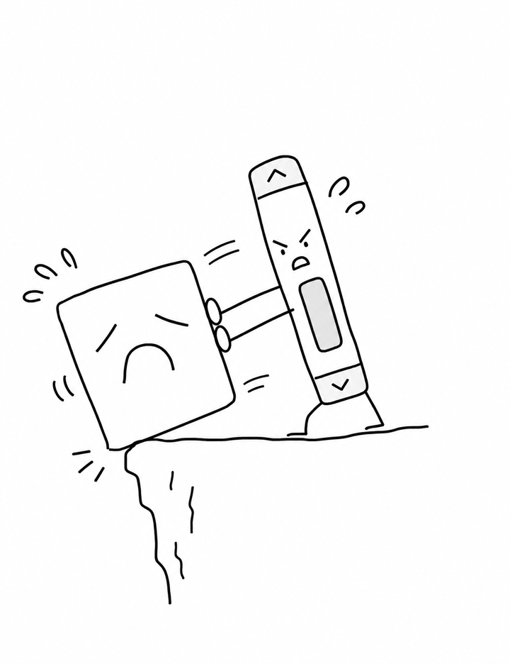
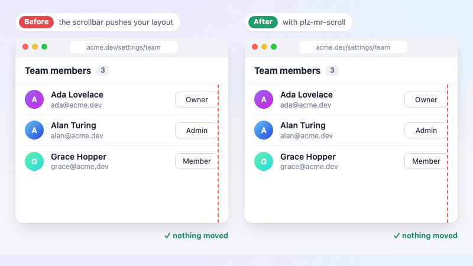
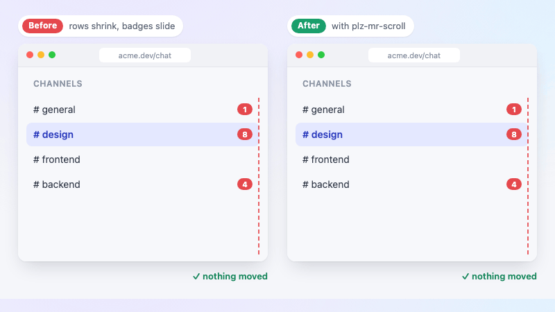
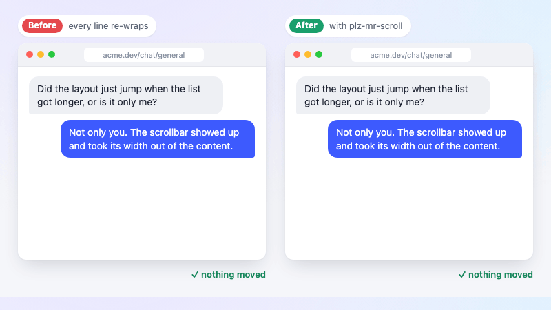
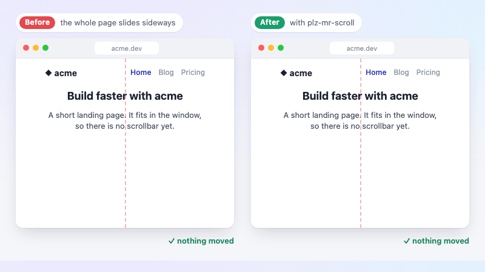
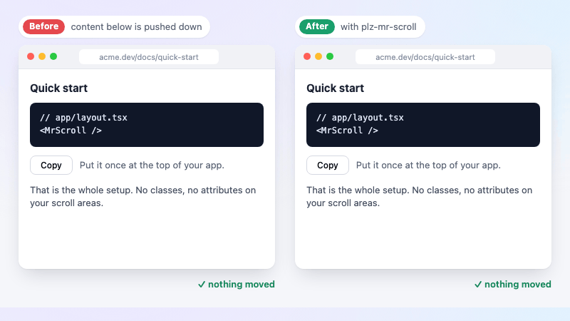
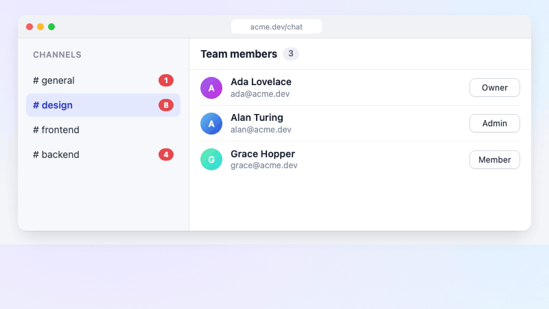

[English](./README.md) · [한국어](./README.ko.md) · [日本語](./README.ja.md) · **简体中文**

<div align="center">

  

</div>

<p align="center"><sub>学礼仪之前的滚动条先生。</sub></p>

<h1 align="center">Don't push me plz, Mr. Scroll.</h1>

<div align="center">

  <b>教滚动条做个绅士的库。</b><br />
  滚动条冒出来，布局也纹丝不动。

</div>

<div align="center">

  

</div>

<p align="center"><b><a href="https://justicehwan.github.io/plz-mr-scroll/">▶ 在线演示，点开试试</a></b></p>

**目录**

- [滚动条先生的问题](#滚动条先生的问题)
- [绅士的礼仪](#绅士的礼仪)
- [更多示例](#更多示例)
- [用法](#用法)
- [站位顺序](#站位顺序)
- [选项](#选项)
  - [文本框（textarea）](#文本框textarea)
- [按区域设置](#按区域设置)
- [查看它做了什么](#查看它做了什么)
- [须知](#须知)
- [浏览器支持](#浏览器支持)
- [文档](#文档)
- [开发](#开发)
- [许可证](#许可证)

```bash
npm install plz-mr-scroll
```

```tsx
<MrScroll />
```

放在应用最顶层，这一行就够了。页面代码里什么都不用加。

&nbsp;

&nbsp;

## 滚动条先生的问题

滚动条先生没有恶意，只是没有规矩。内容一变长，他就不打招呼地闯进来，把好好待着的文字和按钮往旁边推开，推开的距离正好是他自己的宽度。

- 内容被挤开一个滚动条的宽度：换行位置变了，按钮也跟着挪位。
- 滚动条插进右侧，左右留白变得不一样宽。

以往大家是这么安抚他的。


| 常见做法                                       | 不足之处                                            |
| ------------------------------------------ | ----------------------------------------------- |
| 提前把位置留出来（`scrollbar-gutter: stable`）       | 滚动条没来，空椅子也得留着——没有滚动条时会露出一条空白条带                  |
| 手动补右内边距（如 `padding-right: 17px`）           | 每个区域都要手动处理，换到滚动条宽度不同的浏览器就对不上了                   |
| 自己绘制滚动条                                    | 浏览器原生滚动条的行为和外观得从头重做                             |


`plz-mr-scroll` 不赶走滚动条先生，也不找替身，只是教这位先生学规矩：进场之前先找好站的位置；实在没有位置，就谁也不推，安安静静站到边上。

&nbsp;

&nbsp;

## 绅士的礼仪

- **不推人。** 滚动条出现前后，内容的位置不变。
- **不让左右失衡。** 滚动条出现后，左右留白依然一样宽。
- **不乱动别人的家具。** 不改变滚动区域的尺寸。没有滚动条时，页面与使用本库之前完全一样。
- **衣着不变。** 用的是浏览器原生滚动条，不是自绘的；你设置的样式（`scrollbar-width`、`scrollbar-color`、`::-webkit-scrollbar`）也照样沿用。
- **不用招呼，自己会照应。** 自动找出页面上的纵向、横向滚动区域，无需给每个区域加 class 或属性，之后弹出的模态框、下拉菜单也能找到。
- **走的时候收拾干净。** 改过的内边距和标记都会还原。

以上是本库追求的礼仪。绅士也有做不到的事——写在[须知](#须知)里。

&nbsp;

&nbsp;

## 更多示例

每段动图都是同一个界面并排两份 —— 左边不用本库，右边用了。数字是当场测出来的。

| 侧边栏 —— 滚动条站在面板的留白里 | 聊天 —— 换行位置不变 |
| --- | --- |
|  |  |

| 页面跳动 —— 居中的页面依然居中 | 代码块 —— 下方内容不会被往下挤 |
| --- | --- |
|  |  |

打开 `debug` 选项后，每个滚动区域都会画出它是怎么被处理的。



&nbsp;

&nbsp;

## 用法

在应用里安装一次即可，无需任何配置，直接使用。

**React**

```tsx
import { MrScroll } from "plz-mr-scroll/react";

export default function RootLayout({ children }: { children: React.ReactNode }) {
  return (
    <html>
      <body>
        <MrScroll />
        {children}
      </body>
    </html>
  );
}
```

- 不会在页面上渲染任何内容。它在浏览器端挂载后才开始工作，因此不影响服务端渲染的结果。
- 只在组件处于页面上期间运行，所以放在哪里，作用范围就到哪里——放在应用最外层的布局里，作用于整个应用；放在某个页面的布局里，则只在停留在该页面时生效。

Vue · Svelte · 普通网站

```ts
import { installMrScroll } from "plz-mr-scroll";

const uninstall = installMrScroll();

// 卸载时
uninstall();
```

- 核心部分不依赖任何库。React 是可选依赖，不会一起安装。
- 同时提供 ESM（`import`）和 CommonJS（`require`）两种产物，并附带类型定义。
- 在没有 `document` 的环境（如服务端）中引入也不会报错，什么都不做。

&nbsp;

&nbsp;

## 站位顺序

滚动条先生不会把同一种办法硬套到所有地方。每个出现滚动条的区域，他都会先看结构，从上往下，站到第一个合适的位置。


| 顺序       | 结构满足                     | 这样站                       | 会遮住内容吗           |
| -------- | ------------------------ | ------------------------- | ---------------- |
| 1 自身内边距  | 滚动区域的右内边距不小于滚动条宽度        | 把这段内边距缩小一个滚动条宽度，站在腾出的位置上  | 不会               |
| 2 居中     | 内部内容左右两侧的空白一样宽           | 左侧也加上同样的宽度，保持居中           | 不会               |
| 3 外侧留白   | 区域紧外侧有外边距或空位             | 区域保持不变，只让滚动条站到紧外侧         | 不会               |
| 4 叠放     | 哪里都没有位置                  | 叠在内容边缘之上——即便如此也不推挤内容      | 只遮住滑块所在之处，且为半透明  |


- 横向滚动条同理，与纵向各自确定位置。
- 滚动条宽度不靠假设，使用在当前浏览器中实测的值。
- 区域或内容的尺寸、元素、样式发生变化时，会重新判定。
- 整页（浏览器窗口）滚动、预留了滚动条位置的区域（`scrollbar-gutter: stable`）、始终显示滚动条的区域（`overflow: scroll`）也在处理范围内。

各方式的条件，以及在页面上留下的内容，见[工作原理](./docs/zh-CN/how-it-works.md)。

&nbsp;

&nbsp;

## 选项

不传任何选项也能工作。所有选项都作用于整个页面。


| 选项          | 值         | 默认      | 含义                                                         |
| ----------- | --------- | ------- | ---------------------------------------------------------- |
| `stayClose` | 数字（px）    | `12`    | 滚动条浮到外侧时，允许它与区域边缘相距的最大距离。超过则叠放到内容之上                        |
| `exclude`   | CSS 选择器   | 无       | 匹配该选择器的元素及其内部都不处理                                          |
| `debug`     | 布尔值       | `false` | 在页面上画出每个区域做了什么                                             |
| `quiet`     | 布尔值       | `true`  | 拦截浏览器产生的“ResizeObserver loop”提示                             |
| `textarea`  | 布尔值       | `false` | 同样处理文本框（`textarea`）。右内边距不小于滚动条宽度的文本框，会缩小这段内边距以保持文字宽度       |


```tsx
<MrScroll stayClose={4} exclude=".some-widget, .third-party" debug />
```

`installMrScroll({ ... })` 也用同样的名字传入。各选项的细节见[配置](./docs/zh-CN/configuration.md#选项)。

### 文本框（`textarea`）

滚动条先生默认不进文本框，因为文本框容易和“高度随内容自适应”的代码纠缠在一起。如果文本框里文字被挤开让你介意，就打开 `textarea` 选项。

```tsx
<MrScroll textarea />
```

```ts
installMrScroll({ textarea: true });
```

打开后，文本框也按与其他滚动区域相同的顺序处理。但文本框无法浮出滚动条，实际能做到的如下。


| 文本框的状态                                    | 打开后                                            |
| ----------------------------------------- | ---------------------------------------------- |
| 右内边距不小于滚动条宽度                              | 把这段内边距缩小一个滚动条宽度。文字所占宽度不变，所以换行位置不变              |
| 右内边距小于滚动条宽度                               | 保持不变。文字会被挤开一个滚动条的宽度                            |
| 按 `box-sizing: content-box` 写死了宽度（浏览器默认值）  | 保持不变。缩小内边距后文字宽度不会增加，只会让整个框变窄                   |
| 加了 `data-scrollbar="manual"`               | 只提供滚动条宽度（`--sbw`），内边距由你自己决定                    |


- **内边距给足就能接住。** 滚动条宽度因浏览器和设置而异，在 11px 到 17px 之间。把文本框的左右内边距设成不小于该值即可，例如 `padding: 8px 16px`。
- **设置 `box-sizing: border-box`。** 宽度写成具体数值的文本框，在浏览器默认值（`content-box`）下接不住。大多数 CSS reset 已经把它改成了 `border-box`。
- **文本框的尺寸不会变。** 不会改写宽度和高度。
- **“外侧留白”和“叠放”不适用于文本框。** 因为文本框无法单独浮出滚动条。
- **关掉就还原。** 关闭该选项或卸载后，缩小过的内边距会恢复为原值。

&nbsp;

&nbsp;

## 按区域设置

只有自动判定不准的区域，才需要在滚动元素上加 `data-scrollbar`。默认不加。


| 值        | 行为                                                         |
| -------- | ---------------------------------------------------------- |
| `off`    | 不处理该区域                                                     |
| `center` | 即使左右空白略有差异，也按居中方式处理                                        |
| `manual` | 不做自动判定，只通过 CSS 变量提供滚动条宽度（`--sbw`）和高度（`--sbh`）。内边距由你自己决定     |


用法和注意事项见[配置](./docs/zh-CN/configuration.md#按区域设置)。

&nbsp;

&nbsp;

## 查看它做了什么

绅士从不隐瞒自己做过什么。打开 `debug` 后，每个滚动区域选用的方式和原因、滚动条所站的位置、缩小或增加的内边距的前后值，都会画在页面上。

```tsx
<MrScroll debug />
```

读法见[问题排查](./docs/zh-CN/troubleshooting.md#问题排查)。由于每一帧都会重新测量各区域的位置，请只在开发时开启。

&nbsp;

&nbsp;

## 须知

就算是绅士，也有办不到的事。

- **悬浮式滚动条（不占宽度）的环境下什么都不做。** 像 Mac 默认设置或移动端那样，滚动条不占宽度时，本来就没有谁会被挤开。
- **不会改你写成具体数值的右内边距。** 像 `padding-right: 17px` 这样的值，无法判断是给滚动条留的还是设计上的留白。把这个值删掉，就会自动对齐。
- **浮出了滚动条的区域会留下 shadow root。** 它挂在以外侧留白或叠放方式处理的区域上，shadow root 一旦挂上就无法摘除。如果之后有代码要对该元素调用 `attachShadow`，请给它加上 `data-scrollbar="off"` 或 `manual`。
- **有些标签无法浮出滚动条。** 像 `ul`、`table` 这样不能挂 shadow root 的标签，只适用方式 1、2。可以用 `manual` 自己处理。
- **有些区域不处理。** shadow root 内部、iframe 内部。文本框（`textarea`）需要打开 `textarea` 选项才会处理，打开后也无法浮出滚动条——右内边距比滚动条窄的文本框保持原样。
- **浮出的滚动条所在位置的点击由滚动条接收。** 叠放时，指内容右端与滚动条同宽的那一条。
- **判定只是推断。** 它是测量渲染出的尺寸和内边距后做出选择，因此在少见的结构中可能选错方式。这类区域用 `data-scrollbar` 纠正。

完整列表见[限制](./docs/zh-CN/troubleshooting.md#限制)。

&nbsp;

&nbsp;

## 浏览器支持


| 功能                                 | 需要                                                                  | 没有时                    |
| ---------------------------------- | ------------------------------------------------------------------- | ---------------------- |
| 自身内边距 · 居中 · 纵向叠放                  | `ResizeObserver`、shadow DOM                                         | —                      |
| 外侧留白 · 浮出横向滚动条 · 网格和横向排列区域的叠放      | CSS anchor positioning——Chrome、Edge 125，Safari 26，Firefox 147 起      | 纵向改用备用方式或叠放，横向保持原生滚动条不变 |


在 Chromium、Firefox、WebKit 三个引擎上用自动化测试验证。已验证和未验证的范围见[验证情况](./docs/zh-CN/troubleshooting.md#验证情况)。

&nbsp;

&nbsp;

## 文档

- [工作原理](./docs/zh-CN/how-it-works.md) — 站位顺序的细节、重新判定的时机、在页面上留下的内容
- [配置](./docs/zh-CN/configuration.md) — 作用范围、选项、按区域设置（`manual` 的用法）、使用建议
- [问题排查 · 限制 · 验证情况](./docs/zh-CN/troubleshooting.md) — 调试显示的读法、按症状处理、全部限制、已验证的环境

&nbsp;

&nbsp;

## 开发

以下命令面向克隆本仓库、想修改库代码的人。只是使用的话用不到。

```bash
npm install
npm run dev
npm test
```

&nbsp;

&nbsp;

## 许可证

[MIT](./LICENSE) © Justicehwan
